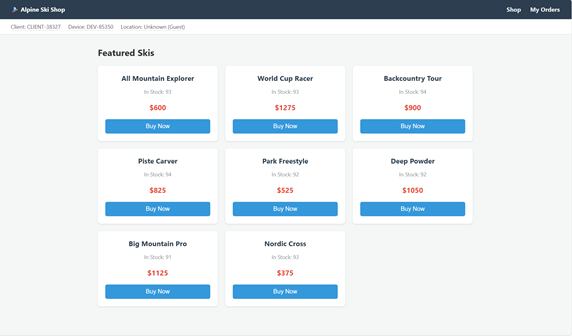
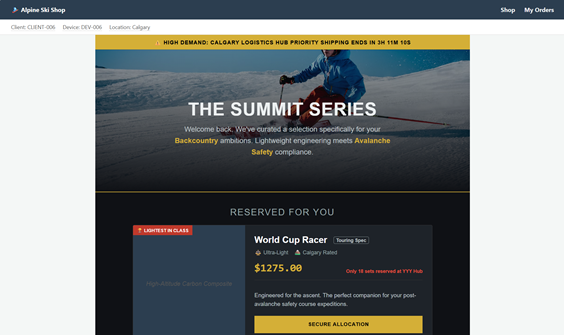

# Terminal Value

This repository is the home of **[terminalvalue.net](https://terminalvalue.net)**, my blog on AI engineering, written by humans and agents, for humans and agents. Posts live in [`blog/posts/`](./blog/posts/).

Below, and in [`projects/terminal-value-pipeline/`](./projects/terminal-value-pipeline/), I've preserved the project that gave this repo its name: an early LLM pipeline I built in February 2026.

---

## Early project: Terminal Value pipeline (Feb 2026)

> Archived experiment, built February 2–March 8, 2026. It's kept as a snapshot and is not under active development. The commit history keeps the original dates.

The pipeline treats an LLM as one transactional step inside an otherwise deterministic system. I summarize this idea as "probabilistic core, deterministic shell." The pipeline takes a **base home page web component** from a mock ski shop:

[](./projects/terminal-value-pipeline/notes/images/base-home-page-example.png)

It combines that component with CRM notes about a specific customer and generates a **customer-specific home page**, fully automated and in one shot, using about 10,000 tokens:

[](./projects/terminal-value-pipeline/notes/images/client-specific-home-page-example.png)

When that customer visits the site, the app serves the generated component instead of the base one.

### Run it

```sh
cd projects/terminal-value-pipeline
npm install
npm start          # http://localhost:4173
```

### Where to look

| Path                                                                                         | What's there                                                                                                                                          |
| -------------------------------------------------------------------------------------------- | ----------------------------------------------------------------------------------------------------------------------------------------------------- |
| [`projects/terminal-value-pipeline/README.md`](./projects/terminal-value-pipeline/README.md) | Full write-up: more generated examples, the architecture, and the project's current state                                                             |
| [`projects/terminal-value-pipeline/notes/`](./projects/terminal-value-pipeline/notes/)       | Writing from the time, including [Approaching LLMs Like an Engineer](./projects/terminal-value-pipeline/notes/1-approaching-llms-like-an-engineer.md) |
| [`projects/terminal-value-pipeline/pipeline/`](./projects/terminal-value-pipeline/pipeline/) | The pipeline: parse customer data, build prompts, generate components                                                                                 |
| [`projects/terminal-value-pipeline/apps/`](./projects/terminal-value-pipeline/apps/)         | The mock ski shop (event sourcing and CQRS) and the Gemini Batch API tooling                                                                          |

---

## Writing posts

Each post is a folder in `blog/posts/<slug>/`, containing an `index.md` and its images. Start one from the template, which shows every element a post can use:

```sh
npm run new -- my-post-slug   # copies blog/templates/post to blog/posts/my-post-slug as a draft
```

[`AGENTS.md`](./AGENTS.md) covers the post format and house style, for people and coding agents alike.

`npm run build` writes the site to `dist/`. Every post is published as HTML at `/posts/<slug>/` and as Markdown at `/posts/<slug>/index.md`. The build also writes `llms.txt` and `feed.xml`. Production builds leave out posts marked `draft: true`.

The build also publishes the pipeline's ski shop demo at `/projects/terminal-value-pipeline/`. It's a static Vite build that runs on mock data in the browser. Run `npm run build:projects` once, and again whenever the project changes, before building the blog.

```sh
npm install
npm run build:projects   # build the static project demos into projects/<name>/dist
npm run dev          # build with drafts, serve at http://localhost:8788
npm run deploy:dev   # build with drafts, deploy to https://dev.terminal-value.pages.dev (noindex)
```

## Deploy

The site is hosted on Cloudflare Pages, in the `terminal-value` project:

```sh
npm run deploy       # build the demo and the blog, deploy to https://terminalvalue.net
```

## License

[MIT](./LICENSE.txt)
