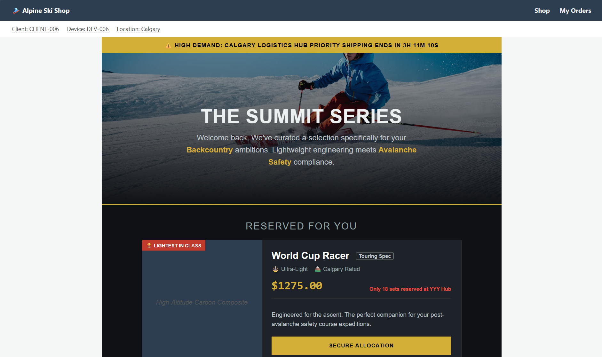
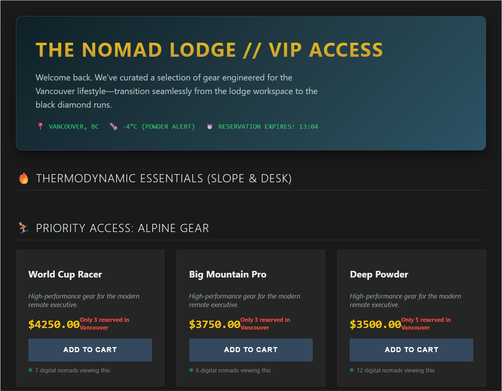
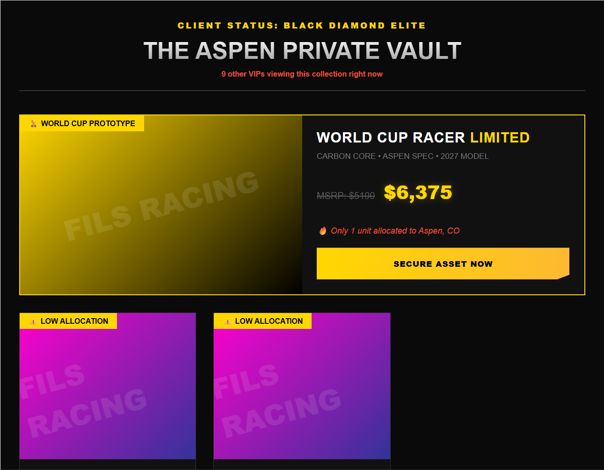
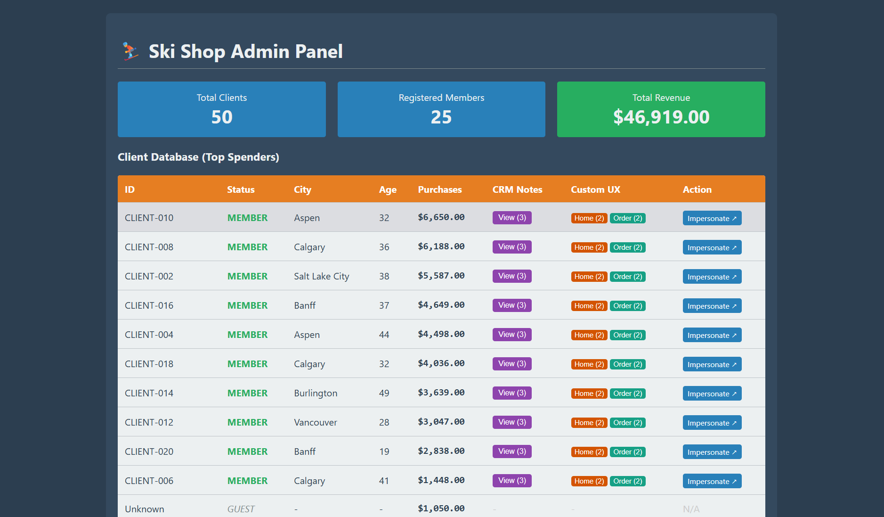
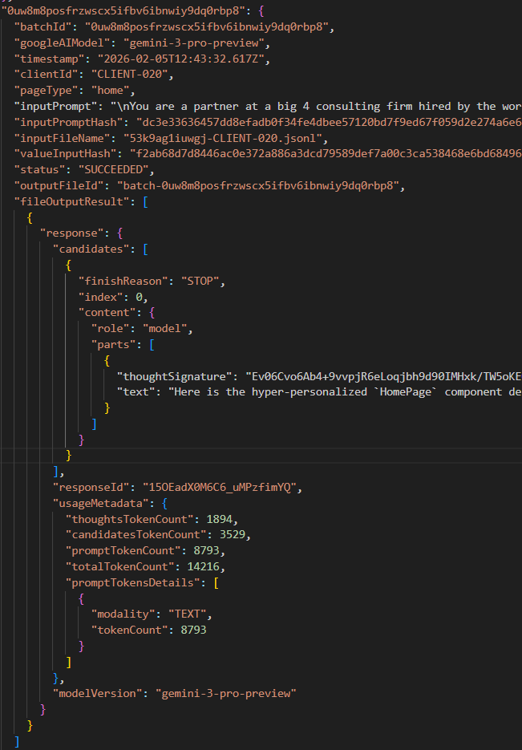
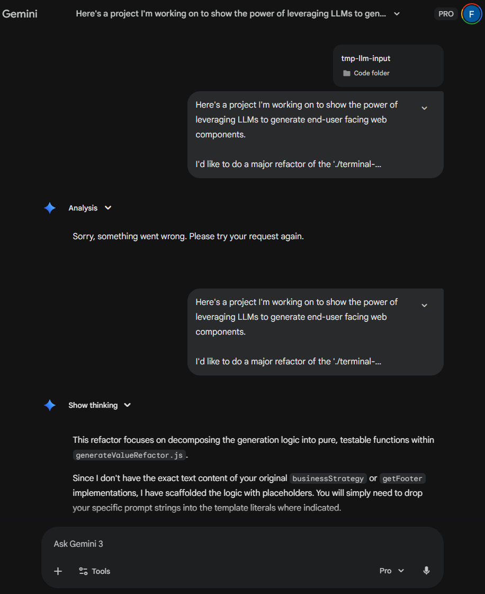
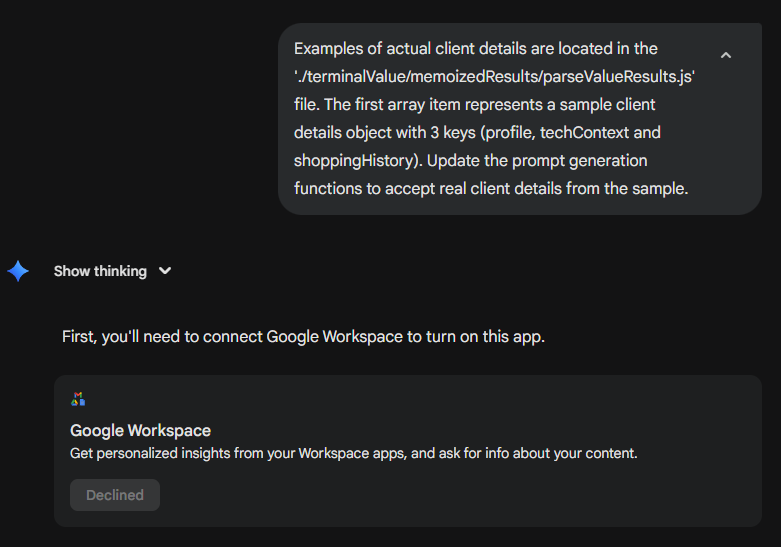

> [!NOTE]
> This post kicks off the blog by revisiting a project I built in February 2026. Every line of the original was written by Gemini 3 using one-shot prompts. This version, from the write-up to the hosted demo, is an LLM rewrite done with Claude Opus 5.5, which did most of the heavy lifting. LLMs have advanced a lot since then, but the concepts still hold, and they're a good grounding for what comes next.

An LLM wrote a custom home page for one customer from three lines of CRM notes. Of the 8,803 tokens in the prompt, only about 100 were about the customer.

 → 

[Open both live, side by side](/projects/terminal-value-pipeline/compare/). Tap a screenshot to enlarge it.

Besides their age and city, this is everything the model knew about them, straight from the shop's CRM:

- Client just got into backcountry skiing and is excited to buy new stuff.
- Attended an avalanche safety course last month.
- Asking about lightweight setups for long tours.

The model returned a complete web component, and the shop serves it whenever that customer visits.

## Where the tokens go

The request for this customer used 14,515 tokens on Gemini 3 Pro:[^data]

- **8,803 input.** About 100 describe the customer. The other 98.9% is identical for every customer: the instructions and the shop's base page code.
- **2,511 thinking.**
- **3,201 output**, which is the new component.

Across the ten customers in the demo, input ranged from 8,793 to 8,815 tokens. A paragraph of customer data is all it takes to turn the same template into a very different page.

Because almost the whole prompt is fixed, it's a natural fit for prompt caching. With the template first and the customer's notes last, every request after the first reads the template from cache while it's warm, at a fraction of the cost and latency. The marginal cost of personalizing a page is then roughly the customer's paragraph plus the output.[^cache]

**[Try the demo](/projects/terminal-value-pipeline/)**. It runs entirely in your browser, with mock data.

## Probabilistic core, deterministic shell

The idea behind the project is to treat the LLM as a probabilistic step inside an otherwise deterministic system. Everything around the model is ordinary code: the data it reads, the prompt it receives, where its output is written, and how that output is served. The model is called once per customer, like a transaction, and the result is stored with everything that produced it.

It isn't quite MCP, vibe coding or agentic AI. It's closer to transactional AI.

## How the pages are generated

The shop records every change as an event, and projections build the current state of each customer from those events. The pipeline reads that state and fills in a prompt template:

```js
// Abridged from pipeline/experimentPrompts.js
const prompt = (profile, notes) => `
The high value client we are targeting is ${profile.age}
years old and based in ${profile.city}. Our executive sales
team has made the following notes in the internal ski shop
CRM database: "${notes}".

Replace the BaseHomePage class in './index.html' with a
custom version for this particular high value client.`;
```

Each generated component is about 10 KB of unminified code. Different notes produce very different pages:





The admin page lists every customer and links to each of their generated pages:



Every run stores the prompt, the raw response and the token usage together, so any page can be traced back to exactly what produced it:



## What building it taught me

Building the project one prompt at a time, without agents, taught me a few principles.

**Precise context.** The more irrelevant tokens in the context, the less predictable the response. "Garbage in, garbage out" is too passive. Input fidelity sets output fidelity.

**Concise context.** Reasoning degrades as the context window fills up. Rather than adding more context, break the problem into pieces small enough for the model's best attention.

**Deterministic guardrails.** Probabilistic output can be checked deterministically. When a model's code starts to go wrong, its style usually degrades first, often in the comments. Static checks on those signals can reject a bad response before a person reads it.

**Recursion of technical debt.** Uncontrolled agent loops tend to write code that works but loses the domain's intent. Repeat that enough times and nobody, human or model, can tell what the code is for.

## When a prompt fails

One refactor of a core file didn't go as planned. My prompt was too long and had a logical flaw, and Gemini returned a generic error instead of code:



Replacing three words to fix the flaw got [the exact refactor I wanted](https://github.com/pilifs/Terminal-Value/commit/ecd2784fcc27c8beab133ce4cdd4dbf33aa7b2f8). The next request in the same chat was a simple change that had worked many times before, but this time the model misread it completely:



I didn't argue with the model. I started a new chat with a one-shot prompt, and [it worked the first time](https://github.com/pilifs/Terminal-Value/commit/2ae0022ba43ba020867d9306aad465a6949bb58d). When context goes bad, it's cheaper to start over than to repair it.

## The code

The project is preserved in [`projects/terminal-value-pipeline`](https://github.com/pilifs/Terminal-Value/tree/main/projects/terminal-value-pipeline), with its original commit history and dates. To run it locally:

```sh
cd projects/terminal-value-pipeline
npm install
npm start
```

[^data]: These figures are the `usageMetadata` Gemini returned for this page, a Gemini Batch API request made on February 5, 2026 with `gemini-3-pro-preview`. Here are the exact [request](gemini-batch-request.jsonl) and [response](gemini-batch-response.jsonl), one JSONL line each. The response holds the generated component in its `text` field. "About 100" is an estimate. The customer's details are about 340 characters, and the prompt averaged about 3.5 characters per token.

[^cache]: The prompts in the demo weren't ordered for caching. The customer's details came about 900 characters in, ahead of roughly 29,000 characters of page code, so a prefix cache could only reuse the first few hundred tokens. Gemini's implicit caching still showed up in an earlier batch that morning. That prompt version opened with the customer's details, yet 4 of its 10 responses reported 8,170 cached tokens out of about 8,500. Those prompts shared only their first 42 characters, so it wasn't a shared template prefix, and the stored data doesn't show what was matched. Implicit caching is best-effort and opaque. For a predictable cost, cache the template explicitly as the prompt prefix (Gemini's context caching or Anthropic's `cache_control`) and append the customer's details after it. Both bill cached reads at a fraction of the normal input price.
