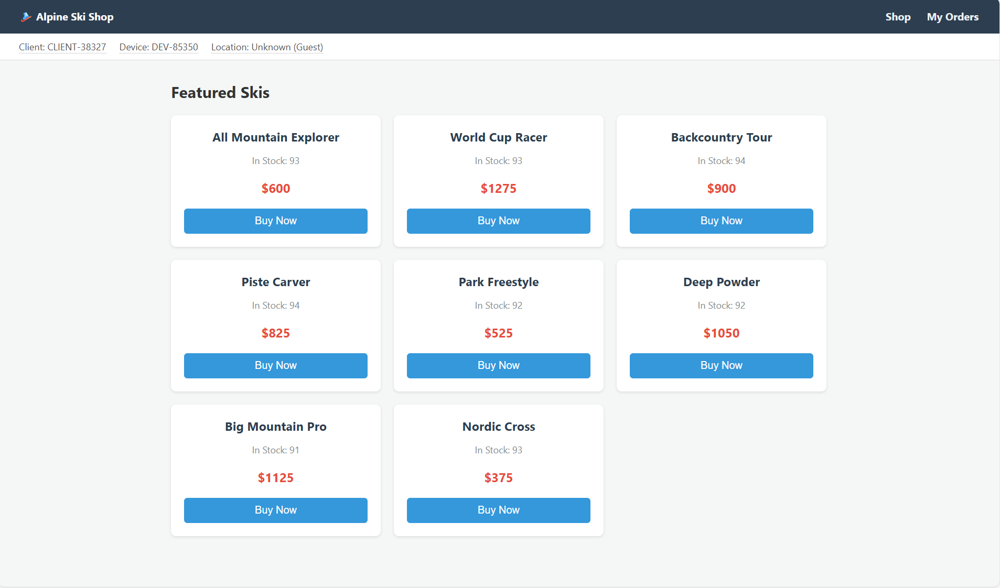

> [!NOTE]
> Optional context box, for things like where a project came from or who helped write the post. Delete it if the post doesn't need it.

Open with the result or the claim, in one or two sentences. The reader should know why the post matters before the first heading.

 → 

The line above is a before and after pair: two images on one line, joined by `→` or `->`. Keep both captions to a few words. Tap either image to enlarge it.

## A section heading

Keep paragraphs short. Each one should make a single point.

A single image fills the column, or a little wider on large screens. The quoted text after the file name becomes the caption:


Code blocks get muted highlighting. Keep them under about 60 characters wide, so they don't scroll on a phone, and cut them down to the lines that matter:

```js
// Abridged from path/to/source.js
const total = orders.reduce((sum, order) => sum + order.amount, 0);
```

Use inline code, such as `generateValue()`, for names from the code.

- Lists work for three or more parallel items.
- Prefer sentences when the points depend on each other.

A footnote holds detail that an expert will want but most readers can skip.[^detail] Put data files, such as `.jsonl` or `.json`, in the post folder and link them by file name.

### A third-level heading

Headings link to themselves, so any section can be shared.

[^detail]: Footnotes render at the end of the post, numbered in order of use.
