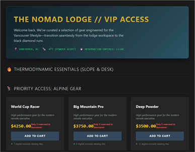
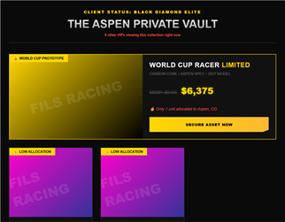
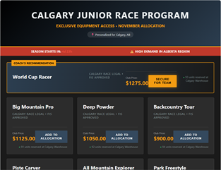
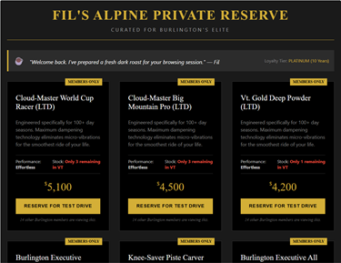
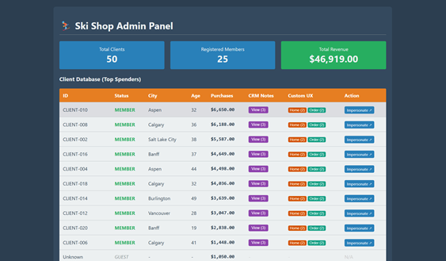

# Terminal Value: A Pipeline That Generates Contextual Web Components Via LLM

> **Archived experiment, built February 2–March 8, 2026.** It's preserved as a snapshot of an early "transactional AI" pipeline and isn't under active development.

This sandbox is built around an architecture concept I summarize as "probabilistic core, deterministic shell." The hypothesis: treat LLMs as probabilistic software systems, and apply engineering principles to mitigate their inherent downsides. Then we can invoke them transactionally to serve higher-order logic in a predictable way.

The pipeline starts from a **Base Home Page Web Component** in a mock e-commerce web app:

[](./notes/images/base-home-page-example.png)

It combines this base component with user-specific context (notes from a CRM system) and feeds it to an LLM, fully automated, to generate a **Client-Specific Home Page Web Component:**

[](./notes/images/client-specific-home-page-example.png)

The app serves and renders this user-specific component on demand when that user visits the mock e-commerce site.

Each custom web component was generated in one shot using about 10,000 tokens, and averages about 4 KB unminified. Raw request and response samples from the Gemini Batch API are in `./apps/gemini-batch/local-inputs`. They include the prompt input, the LLM response and token usage metadata.

The result isn't quite MCP, vibe coding, LLM-as-a-compiler or agentic AI. It's something in between, closer to "transactional AI."

## Run It

Requires Node 24 (see `engines` in `package.json`).

```sh
cd projects/terminal-value-pipeline
npm install
npm start          # builds with Vite and serves at http://localhost:4173
```

Everything runs client-side. A mock server in `apps/example-ski-shop/public/server.js` intercepts `fetch` and persists to `localStorage`, so the build can be served from any static host or CDN.

Some generated components to try once it's running:

- [CLIENT-006: backcountry adventurer (shown above)](http://localhost:4173/?clientId=CLIENT-006&homeHash=f2ab68d7d8446ac0e372a886a3dcd79589def7a00c3ca538468e6bd68496ce7f&page=home)

[](./notes/images/nomad-lodge-example.png)

- [CLIENT-012: digital nomad](http://localhost:4173/?clientId=CLIENT-012&homeHash=f2ab68d7d8446ac0e372a886a3dcd79589def7a00c3ca538468e6bd68496ce7f&page=home)

[](./notes/images/aspen-private-example.png)

- [CLIENT-004: trust-fund elite](http://localhost:4173/?clientId=CLIENT-004&homeHash=f2ab68d7d8446ac0e372a886a3dcd79589def7a00c3ca538468e6bd68496ce7f&page=home)

[](./notes/images/calgary-race-example.png)

- [CLIENT-008: ski racer parent](http://localhost:4173/?clientId=CLIENT-008&homeHash=f2ab68d7d8446ac0e372a886a3dcd79589def7a00c3ca538468e6bd68496ce7f&page=home)

[](./notes/images/retired-reserve-example.png)

- [CLIENT-014: retired enthusiast](http://localhost:4173/?clientId=CLIENT-014&homeHash=f2ab68d7d8446ac0e372a886a3dcd79589def7a00c3ca538468e6bd68496ce7f&page=home)

Compare them with the [base home page](http://localhost:4173/), which is the one used in the prompt. The [admin page](http://localhost:4173/admin.html) lists every client and links to their other generated pages.

[](./notes/images/ski-shop-admin-page.png)

All input prompts, outputs, client data and Gemini metadata are in [`apps/gemini-batch/results/skiShopResults.js`](./apps/gemini-batch/results/skiShopResults.js). Here's a snippet of the data structure:


The `text` field under `fileOutputResult` is the LLM response. It contains the code for the user-specific home page web component shown in the screenshots above.

## Structure

| Path                    | What it is                                                                                                                                                                                                                                                  |
| ----------------------- | ----------------------------------------------------------------------------------------------------------------------------------------------------------------------------------------------------------------------------------------------------------- |
| `apps/example-ski-shop` | The mock e-commerce app, with event sourcing and CQRS. Generated components live in `public/components/dynamic{Home,Order}/<prompt-hash>/`.                                                                                                                 |
| `apps/gemini-batch`     | A CLI and utilities for the Gemini Batch API (`npm run gemini`). The original web UI's server was removed, but `public/` is kept for reference.                                                                                                             |
| `pipeline`              | The Terminal Value pipeline: parse client data, build prompts, generate components, write them into the ski shop. `worker/manualObservations` holds side-by-side outputs from other models.                                                                 |
| `notes`                 | Writing from the time: [Approaching LLMs Like an Engineer](./notes/1-approaching-llms-like-an-engineer.md), [Architecture as Context](./notes/2-architecture-as-context.md) (draft), and [How This Code Was Written](./notes/how-this-code-was-written.md). |

### Ski shop architecture

[Events](./apps/example-ski-shop/init/generateEvents.js) → [Projections](./apps/example-ski-shop/init/projections.js) → [Database](./apps/example-ski-shop/store/db.js)

The ski shop uses an event sourcing / CQRS pattern to tightly control every state change. Projections simulate strongly consistent writes and eventually consistent reads. In theory, this makes it easy to add features that watch for relevant changes and regenerate the affected custom views. It's a pattern that large online retailers use, and one that LLMs seem to handle well.

### Pipeline architecture

[Database](./apps/example-ski-shop/store/db.js) → [Parse Data](./pipeline/parseValue.js) → [Construct Base Prompts](./pipeline/generateValue.js) → [Generate Contextual Components](./pipeline/coreServices.js) → [Write Components](./pipeline/generateDynamicFiles.js)

## Known State

This is a snapshot of fast-moving experimental code, with the rough edges you'd expect:

- `npm test` runs functional snapshot tests against `pipeline/functionalTests/fixedMocks`. The `generateValue` and batch-metadata fixtures drifted as the prompts evolved, so 2 of the 3 checks fail. The Gemini service also throws on import unless `GEMINI_API_KEY` is set. Any placeholder value works for the offline tests.
- Calling Gemini (`npm run gemini`) needs a real key in `.env` (see `.env.example`).

[](../../LICENSE.txt)
